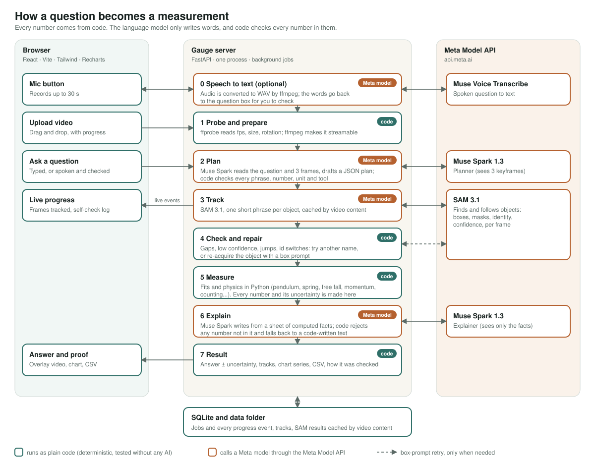

# Gauge

**Turn any phone camera into a measuring instrument.** Upload a video of an experiment or a machine, ask a question in plain English (typed or spoken), and get real measurements with their uncertainty, plus visual proof.

> Chatbots guess. Manual tools like Tracker and Kinovea take hours. Gauge measures, from one question, and shows its proof.

Built for the **Meta Global AI Developer Hackathon** (Cerebral Valley), Indie Developer track, theme *Push the Frontier*.

**All of this code was written during the hackathon (October 26 to November 4, 2026).** The commit history of this repository starts on the first day and shows the work growing step by step.

Live demo: _added at submission_ · Demo video: _added at submission_

---

## What it does

1. **Upload** a video (MP4 or MOV, from a phone is fine).
2. **Ask** a question, for example *"What is the swing period?"*, *"What is the spring's frequency?"*, *"How many parts crossed the line?"*. Tap the microphone to say it instead.
3. **Watch** Gauge work: frames tracked, and a plain-language log of how it checks and repairs its own tracking.
4. **Get** the answer as a number with an uncertainty (for example `0.8582 ± 0.0016 s`), the video with every tracked object outlined, numbered and followed by its path, a chart of the data with the fitted curve, a short explanation, the warnings that matter, and a CSV of the tracked data.
5. **Ask follow-ups** about the same video. Tracking already done is reused, so a follow-up costs almost nothing. If a measurement needs something Gauge cannot know (the string length, a mass), it stops and asks, and it never guesses.

Gauge answers only what you ask. When it cannot measure something, it says so and says why, instead of giving a confident wrong number.

## The principle: measured, not guessed

AI models do the perception and the language. **Every number comes from deterministic Python code** working on the tracking data, and the language model is never allowed to create one.

- **SAM 3.1** finds and follows objects in the video.
- **Muse Spark** turns the question into a plan and writes the explanation. Its plan is a *draft*: code re-checks every object phrase, every number the user said (the quote must really be in the question, units are converted by code, a number that cannot be re-read from the words is sent back for confirmation) and every tool choice.
- **Python** fits, measures and computes the uncertainty.
- **A number check** reads the explanation before you see it. Every number in it must come from the computed facts. A rejected explanation is retried once, then replaced by a text written entirely in code. A wrong number cannot reach the screen.



## Use of Meta's models and tools

| Meta tool | What Gauge uses it for |
|---|---|
| **SAM 3.1** (video) | Concept prompts for tracking (one short noun phrase per object, parallel requests for several objects); per-frame confidence; one-bit masks; **box prompts** to re-acquire an object that was hidden (up to 16 objects in one request, forward or backward); results cached by the video's content so follow-ups are free |
| **Muse Spark 1.3** | Planner: reads the question **and three keyframes** (it must name objects by how they look; on one clip "pendulum bob" found nothing, "glass marble" found it), strict JSON-schema output. Explainer: writes from a sheet of computed facts |
| **Muse Voice Transcribe** | Spoken questions. The words come back to the question box for you to check, and are never asked automatically, because a mis-heard number would ruin a measurement |
| **Meta Files API** | One upload per video, reused by every request; uploads expire after 30 days, and a missing file is uploaded again automatically |
| **`@meta-sam/react`, `@meta-sam/parser`, `@meta-sam/graphics`** | The `<Video>` player draws SAM's real masks on the clip; Gauge's own overlay (numbered boxes, motion paths) uses the same colours and sits on top |

## The self-checking loop

SAM can lose an object behind something, jump to a look-alike, or return nothing. Gauge looks for exactly these problems in every track and picks the repair that fits the problem:

- **Nothing found, low confidence, or a jump** → try other names for the object (up to three), keep the best track.
- **A gap** (the object was hidden) → a new name cannot see through it, so Gauge goes straight to a **box prompt** from the last good frame and follows the same object. A repaired track is checked against the original: it must start next to the old one, and frames that were already good are never overwritten.
- **Identity switches** → tracks that never overlap in time and meet at the same place are joined.
- **Several objects** → all lost objects are re-acquired in one request; a re-acquired object that lands on a neighbour is rejected; a moving camera is detected and warned about.
- **Anything left** → a plain explanation and advice on how to film it better.

Every step is written to a visible log ("How Gauge checked its work"), live while it runs.

## Measurement tools

| Tool | What it measures |
|---|---|
| `pendulum_period` | Period of a damped swing, with the clean stretch found automatically (set-up motion is left out and reported). With a string length: **g = 4π²L/T²** compared with 9.81 m/s² |
| `oscillation_frequency` | Spring and mass: frequency, damping ratio, spring constant *k* from the mass. Damping is reported as "not measurable" when it cannot be told apart from zero |
| `free_fall` | Acceleration from the falling path as a vector (so a tilted phone does not matter), with the scale uncertainty included |
| `velocity_acceleration` | Speed, peak speed, acceleration along a path; on a ramp, compares with g·sinθ for sliding and for rolling bodies |
| `collision_momentum` | Total momentum before and after each impact, kinetic-energy ratio, per-impact list; works without a scale as a percent change |
| `count_objects`, `line_crossings` | Distinct objects, crossings of a line by direction, rate per minute |

**Uncertainty is meant to be honest.** For the pendulum, the quoted ± is the largest of three things: the fit's own error (widened for correlated noise), cycle-to-cycle scatter, and the limit set by the frame rate. The fit alone was far too optimistic on real clips.

## How it was checked

- **Known answers first.** Every tool is tested on simulated motion with a known truth. The tools are calibrated on random simulated runs: the spring tool's 2σ interval covered the truth in 100 of 100 runs for frequency, damping and *k*; the free-fall and ramp tools were calibrated on 150 random runs each, with the scale error removed so the statistical part is tested on its own.
- **Real clips second.** On two real pendulum videos the pendulum tool, the spring tool and the velocity tool agree with each other (frequency = 1/period exactly; peak speed from local fits within 0.4% and 4% of amplitude × ω). The line-crossing counter, with the line at the pendulum's rest position, finds the same swing timing as the pendulum tool (two crossings per swing). A Newton's cradle video gives exactly 7 objects.
- **Failure paths are tested too:** a still object jittering by 0.1 px is *not* reported as a pendulum; an object that is hidden for 50 frames is re-acquired within 0.3 px of where SAM's own track says it is.
- **Tests:** 424 backend tests and 85 frontend tests, none of which need the network (the model and SAM are replaced by fakes that behave like the real ones).

## Limits (stated plainly)

- Needs a still camera for best results; camera motion is detected and warned about, not corrected.
- Distances need a scale (a known length in the picture, said or typed). Without one, time-based measurements (period, frequency, counts) still work and distance-based ones are given in pixels with a warning.
- At 30 fps fast events fall between frames: film in slow motion for collisions and drops. Gauge warns when the frame rate is the limit.
- The reference object must be in the same plane as the motion (perspective is not corrected).
- Answers depend on SAM finding the object; results can vary slightly between runs, which is why tracking is cached.
- Gauge is a measurement instrument, not a coach or an analyzer of people.

## Run it yourself

You need Python 3.11+ (developed on 3.13), Node 22.9+, `ffmpeg`, and a Meta Model API key.

```bash
git clone https://github.com/shedybaba/Guage.git
cd Guage
cp .env.example .env            # then put your key in MODEL_API_KEY
python3 -m venv backend/.venv
backend/.venv/bin/pip install -r backend/requirements-dev.txt
cd frontend && npm ci && npm run build && cd ..
cd backend && .venv/bin/python -m uvicorn app.main:app --port 8000
```

Open <http://localhost:8000>. The server serves the built site and the API from one address. The interactive API reference is at `/docs`.

For development with hot reload, run `npm run dev` in `frontend/` (port 5173, it proxies `/api` to port 8000).

Run the tests:

```bash
cd backend && .venv/bin/python -m pytest -q
cd frontend && npm test && npm run typecheck
```

A 12-second phone clip is about 360 frames, which costs about **$0.07** of SAM and a fraction of a cent of Muse Spark. Questions about a video that has already been tracked cost no SAM at all.

## The API

Everything the site does is a plain HTTP call, so other apps can plug Gauge in:

```bash
curl -F "file=@pendulum.mp4" http://localhost:8000/api/videos
curl -X POST http://localhost:8000/api/videos/<video_id>/questions \
  -H "Content-Type: application/json" -d '{"question": "What is the swing period?"}'
curl -N http://localhost:8000/api/jobs/<job_id>/events     # live progress (server-sent events)
curl http://localhost:8000/api/jobs/<job_id>               # status and result
```

`POST /api/transcribe` turns a recorded question (up to 30 seconds) into text. The full list of calls, with examples, is on the site at `/developers` and in the interactive reference at `/docs`.

## Deploy (Railway)

The repository has a `Dockerfile` (it builds the website, then runs the Python server with ffmpeg) and a `railway.json`. On Railway:

1. Create a project from this repository. Railway builds the `Dockerfile`.
2. Add a **volume** mounted at `/data` (videos, results and the SQLite database live there).
3. Set the variable `MODEL_API_KEY`. Recommended for a public site: `GAUGE_DAILY_SAM_FRAMES=30000` to cap daily spend.
4. Generate a public domain. The site must be served over HTTPS for the microphone to work (browsers require it); Railway domains are.

Other settings, all optional, are listed in `.env.example` (upload size, concurrent jobs, hourly limits, job timeout).

Public deployments have cost guards that apply to everyone together: 300 MB uploads, 15,000 frames per video, 2 jobs working and 12 waiting, 120 questions an hour, a daily SAM frame budget and a 15 minute timeout per job.

## Repository layout

```
backend/app/        FastAPI app, job runner, SQLite store
  planner.py        Muse Spark: question + keyframes -> checked plan
  sam.py            SAM 3.1 requests, parsing, content-hash cache
  quality.py        track checks and the repair loop
  tools/            the measurement tools (pure functions)
  explain.py        facts sheet, Muse Spark explanation, number check
  transcribe.py     spoken questions via Muse Voice Transcribe
backend/tests/      pytest: tools on simulated motion, API with fakes
frontend/src/       React app: upload, question box (with mic), live progress, result
frontend/tests/     Vitest
docs/               architecture diagram, demo video script
scripts/            command-line demos that run one stage on a real clip
Dockerfile, railway.json
```
